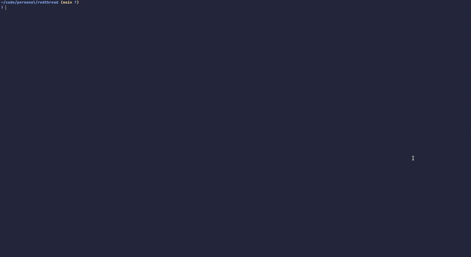
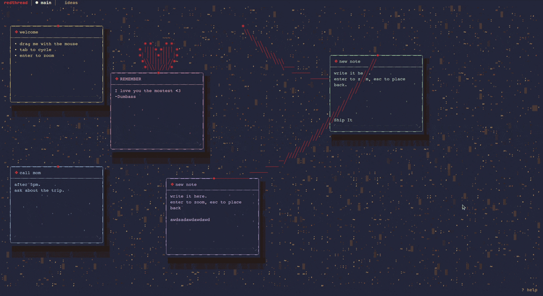
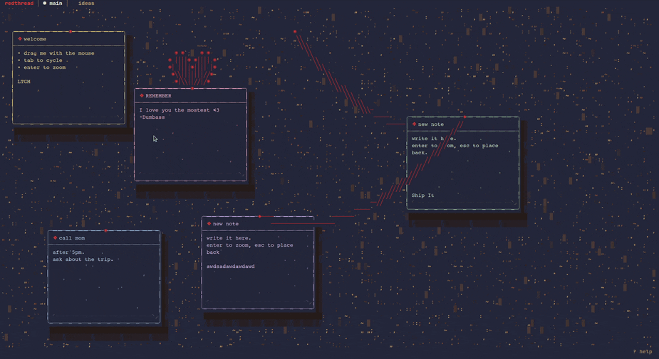
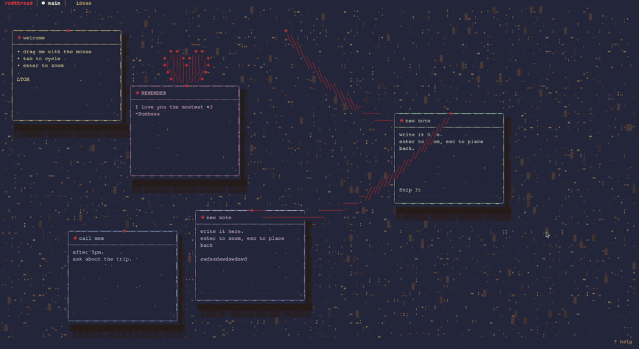

# redthread

A sticky-note pegboard for your terminal. Mouse-first, keyboard-friendly,
transparent over your tmux theme. ASCII-textured cork, dangling red
strings, smooth zoom, and multiple named boards you can switch between.



---

## What it is

- A small TUI meant to live in a tmux pane, always open.
- A cork pegboard rendered entirely in ASCII — your terminal background
  shows through, no solid fill.
- Sticky notes you drag with the mouse or nudge with the keyboard.
  Colored paper, red pin, ornate woven borders, paper-fiber flecks,
  drop shadow, fold glyph.
- **Red strings** between notes (or pinned to bare cork). Slack or
  tight. In-front-of or behind the notes. A weighted "swoop" while you
  pull the free end.
- **Multiple named boards** you cycle through like tmux windows
  (`work`, `personal`, `ideas`, …). Each board has its own notes,
  strings, zoom, font, highlight color, and a unique cork grain.
- **Configurable background** — two independent axes from a live-preview
  popup (`b`): an ASCII-cork on/off toggle, and a fill color (transparent so
  the terminal/tmux theme shows through, a curated palette of dark *and*
  light editor themes, or a custom hex). Mix freely — cork over a dark
  color, or cork off for a clean solid. One global choice for the workspace.
- **Light and dark palettes** — the board renders foreground-only, so its
  colors have to match your terminal background. redthread detects that
  background at startup and picks the matching palette; `T` flips it, and
  `--theme=light|dark` or `RT_THEME` forces it when detection can't see
  through tmux or ssh. See [Theme](#theme).
- **Workspace zoom** — 5 levels (`-3..+1`) that scale note sizes *and*
  positions, so you can pack many stickies into an overview or lean in
  on a few.
- **3D zoom-to-edit** — a smooth scale + lift + shadow animation that
  settles into a card with a live textarea.
- **9 paper tints + 9 highlight colors + 8 text styles** (Unicode math
  alphabets: plain, bold, italic, bold-italic, script, fraktur,
  double-struck, monospace).
- **Undo everything** — a 50-step undo/redo stack covering every change:
  paste, edit, tint, move, string, note delete, even a deleted board. `u`
  undoes, `ctrl+r` redoes.
- Persists to `$XDG_DATA_HOME/redthread/notes.json` with debounced writes,
  keeping the last 20 distinct versions under `backups/`.

## Install

Requires **Go 1.23+**.

```bash
git clone https://github.com/B33pBeeps/redthread.git
cd redthread
go build -o redthread ./cmd/redthread
./redthread
```

Or:

```bash
go install github.com/B33pBeeps/redthread/cmd/redthread@latest
redthread
```

First run with no save file gets a small demo board. `redthread --fresh`
ignores the save and reseeds.

## Theme

The board sets only foreground colors and lets your terminal background
show through, so the palette has to know whether that background is dark
or light. On startup redthread asks the terminal for its background color
and picks the matching palette.

Plenty of setups swallow that query — tmux without `allow-passthrough`,
some ssh sessions, anything that isn't a TTY. When the answer doesn't come
back, redthread assumes dark. Override it:

```bash
redthread --theme=light     # force the light palette
redthread --theme=dark      # force the dark palette
redthread --theme=auto      # detect (the default)

export RT_THEME=light       # same, for your shell rc or tmux config
```

Precedence is `--theme` → `RT_THEME` → the saved choice → detection.

Inside the app, `T` toggles light/dark and remembers it, so the next launch
skips detection entirely. The choice is stored per workspace in
`notes.json`.

`--theme=auto` is an override like the other two, not the absence of one:
it re-detects *and* forgets a saved choice, so it's the way back to
detection after pressing `T`. (Deleting the `theme` key from `notes.json`
does the same thing.)

Both palettes carry the same nine tints and nine highlight colors under the
same names, so switching themes never disturbs a note's saved colors.

## Demos

### Notes & feel

Click without moving for a small jiggle, drag for a drop bounce, `tab`
cycles with the same jiggle, `enter` zooms into a card with a smooth 3D
transition, `esc` lands back with a thud.



### Red strings

Pull strings between notes (or to bare cork as wall-pins) — the free end
swoops behind the cursor with weight. `[ ]` cycles the hovered string;
`t` toggles tight / slack; `f` toggles in-front-of / behind notes; `x`
cuts. Strings stay visibly attached when you drag a note.



### Boards

Top tab bar shows all boards; each has its own cork grain so they feel
distinct. `>` / `<` cycle, `B` creates and drops you straight into rename,
`R` renames, `D D` deletes (two-press confirm).



## Controls

### Mouse

| | |
|---|---|
| click a note | select + raise |
| drag | move (drops with a bounce) |
| drag bottom-right corner | resize the note |
| double-click | zoom-to-edit |
| click empty cork while pulling a string | place a wall-pin |

### Keyboard — board

| key | action |
|---|---|
| `tab` / `shift+tab` | cycle note selection |
| `← ↑ ↓ →` or `hjkl` | nudge (overshoots in motion direction) |
| `shift + ← ↑ ↓ →` | nudge ×5 |
| `H` / `L` | shrink / grow selected note width |
| `K` / `J` | shrink / grow selected note height |
| `enter` | zoom-to-edit |
| `n` / `d` / `r` | new / delete / raise note |
| `u` | undo (multi-step: covers every change, not just deletes) |
| `ctrl+r` | redo |
| `ctrl+y` / `ctrl+p` | copy / paste the selected note |
| `1` – `9` | tint the selected note (yellow, pink, blue, green, purple, orange, teal, cream, coral) |
| `c` | cycle the global highlight (border) color |
| `T` | toggle the light / dark palette (remembered across launches) |
| `a` | open the font menu (live preview, enter to commit, esc to cancel) |
| `b` | open the background menu — toggle cork (`←`/`→`) and pick a fill color (transparent, a curated palette of dark and light editor themes, or custom hex); live preview, enter to commit, esc to cancel |
| `-` / `=` / `0` | zoom out / in / reset (5 levels) |
| `s` | start pulling a red string (arrows/`hjkl` nudge endpoint, `tab` snap to next note, `enter` commit, `esc` cancel) |
| `[` / `]` | cycle the hovered string |
| `t` | toggle tight / slack on the hovered string |
| `f` | toggle in-front-of / behind notes |
| `x` | cut the hovered string |
| `X` | cut every string on the selected note |
| `?` | toggle the help panel (slides up from the bottom) |
| `q` / `ctrl+c` | quit (saves) |

### Keyboard — boards

| key | action |
|---|---|
| `>` (or `.`) | next board |
| `<` (or `,`) | previous board |
| `{` / `}` | re-order: move the active board left / right (wraps) |
| `B` | new board (drops you into rename) |
| `R` | rename the active board |
| `D` | delete the active board (press twice within 2s; refuses if it's the last one) |

### Keyboard — edit

| key | action |
|---|---|
| typing | edit body (first non-empty line is the title; text renders in the board's font) |
| `ctrl+y` / `ctrl+p` | copy the note / paste at cursor (system clipboard) |
| drag mouse | native terminal selection — copy with your terminal's hotkey |
| `esc` | close + save with reverse transition |
| `ctrl+s` | save without closing |

## Data

Notes live at `$XDG_DATA_HOME/redthread/notes.json`, defaulting to
`~/.local/share/redthread/notes.json`. Writes are debounced (400 ms) so
rapid drags coalesce into one flush.

A legacy `brainfartadhdfixerupper/` directory auto-migrates on first
launch under the new name. v3 single-board files migrate forward into
the v4 workspace envelope.

### Undo and backups

`u` undoes and `ctrl+r` redoes, up to 50 steps. The stack covers *every*
change — pasting over a note, an edit, a tint, a move, a string, a deleted
note, a deleted board — not only deletions. A whole editing session
(`enter` … `esc`) undoes as one step, and a held arrow key coalesces into
one step rather than forty.

Because pasting replaces a note's entire contents, `ctrl+p` over a note
that already has text asks first: the footer reads `ctrl+p again to
replace <title>`, and only a second press within 3 seconds commits.

Undo lives in memory, so for anything that outlives the session there are
on-disk backups. Each save that actually changes something first copies
the previous `notes.json` to:

```
~/.local/share/redthread/backups/notes-YYYYMMDD-HHMMSS.nnnnnnnnn.json
```

The newest 20 are kept; saves that would write identical content don't
rotate, so idling doesn't flush real history out of the ring. To recover,
copy one back over `notes.json` while redthread is closed:

```bash
cd ~/.local/share/redthread
ls backups/                       # newest last
cp backups/notes-20260814-160355.812734000.json notes.json
```

The workspace also stores a global `background` preference with two independent
fields: `cork` (the ASCII texture overlay, on/off) and `color` (a hex fill, or
omitted/`""` for transparent). For example `{"cork":false,"color":"#1a1b26"}` is
a solid Tokyo Night background with no cork. Files written before this option
load as cork-on + transparent, unchanged.

Schema (v6):

```json
{
  "schemaVersion": 6,
  "activeIdx": 0,
  "background": { "cork": true },
  "theme": "light",
  "boards": [
    {
      "name": "main",
      "grainSeed": 1777118907643042768,
      "zoom": 0,
      "textMode": 0,
      "highlightColor": 0,
      "notes":   [ { "id": "…", "title": "…", "body": "…",
                     "x": 3, "y": 1, "tint": "yellow",
                     "created": "…", "updated": "…" } ],
      "strings": [ { "a": { "note": "idA" }, "b": { "note": "idB" },
                     "tight": false, "front": false } ]
    }
  ]
}
```

`theme` is `"light"`, `"dark"`, or absent for auto-detect. v5 files simply
lack the key and load as auto, so nothing needs migrating.

## Customizing

Colors live in `internal/app/palette.go`, as two `Palette` values:

- `darkPalette()` / `lightPalette()` — the full color set for each
  terminal background, including `Tints` (the 9 paper colors),
  `SelBorderChoices` (the 9 highlight colors), the cork shades, the
  shadow, and the chrome.
- `ApplyTheme(light bool)` installs one of them into the package-level
  vars every draw site reads.

Text styles and character pools stay in `internal/app/theme.go`:

- `TextModes` — the Unicode-alphabet font options.
- `StarChars` / `PoreChars` / `BlotchChars` — cork-texture char pools.

Edit any of those, rebuild, and the whole app picks up the new values
(help panel + menu + cycle included).

When adding colors, note the rule the palettes follow: **text** needs
enough contrast to read (the light palette keeps ink under ~0.5 Rec-601
luma), but **texture** — cork specks, shadow dither — must instead sit the
*same distance* from the background as its dark counterpart sits from
black. Making texture merely "dark enough" turns the board into noise.
`theme_test.go` enforces both rules.

## File layout

```
cmd/redthread/
  main.go           thin entry — calls internal/app.Run()

internal/app/
  app.go            Run(): flag parsing, load/seed workspace, launch
  model.go          MVU (Model/Update/View, key + mouse routing,
                    tab bar, help panel, rename mode)
  notes.go          Note, Board, Workspace, StringConn, cork gen
  draw.go           cork + note rendering (shadow, tape, borders,
                    text, fibers)
  wire.go           red-string curve rendering + pull physics
  render.go         cell grid + coalesced ANSI emitter (transparent bg)
  theme.go          color type, dither, halftone, text styles
  palette.go        the dark + light palettes and ApplyTheme
  theme_mode.go     --theme / RT_THEME parsing + background detection
  anim.go           zoom transition timeline + easings
  edit.go           canvas-drawn edit frame + bubbles/textarea splice
  menu.go           font-picker + background picker popups
  storage.go        XDG JSON persistence, migrations, backup rotation
  history.go        undo/redo stack over workspace snapshots

docs/
  screenshot.png

DESIGN.md           early design notes (historical)
```

## Changelog

**Latest**

*Features*
- Background is now configurable — press `b` for a picker with two independent axes:
  a **cork on/off toggle** (`←`/`→`) and a **fill color** — **transparent** (your
  terminal/tmux background shows through, the default), a curated **dark-theme palette**
  (github dark, tokyo night, catppuccin, dracula, nord, …), or a **custom hex**. Mix
  freely; the choice is global to the workspace and persists.
  ([#1](https://github.com/B33pBeeps/redthread/issues/1))

**Previous**

*Fixes*
- Fullwidth font removed — it never rendered correctly.
- `}` (move-active-board-right) was a no-op; it now actually shifts the active board.
- Opening a freshly created blank note no longer drops the cursor two rows below the title.

*Features*
- New notes start empty (only the initial seed has demo content).
- Open notes now render in the board's selected font.
- Strings are fully keyboard-drivable from `s` — arrows / `hjkl` nudge the free end, `tab` snaps to next note, `enter` commits, `esc` cancels.
- Boards re-orderable in the tab bar with `{` and `}`.
- Native terminal text selection inside open notes (mouse capture is released in edit mode).
- `ctrl+y` copies the selected note's text; `ctrl+p` pastes — into the cursor in edit mode, or onto the selected note in board mode.
- `u` undoes the most recent note delete (restores connected strings too).
- Subtle dim-crossfade + horizontal slide when switching boards.

## License

Personal project. MIT — use it, fork it, do whatever.

---

<a href="https://www.star-history.com/?repos=B33pBeeps%2Fredthread&type=date&legend=top-left">
 <picture>
   <source media="(prefers-color-scheme: dark)" srcset="https://api.star-history.com/chart?repos=B33pBeeps/redthread&type=date&theme=dark&legend=top-left" />
   <source media="(prefers-color-scheme: light)" srcset="https://api.star-history.com/chart?repos=B33pBeeps/redthread&type=date&legend=top-left" />
   
 </picture>
</a>
